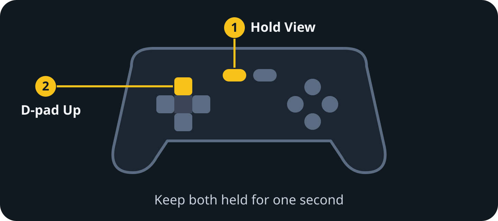

# The menu

| With | Open the menu |
|---|---|
| Steam Controller, Steam Deck | Hold <kbd>View</kbd>, press <kbd>D-pad Up</kbd>, keep both for one second. |
| Other gamepad | The same two buttons. Your side pauses while the menu is open. |
| Keyboard | <kbd>Ctrl</kbd>+<kbd>Shift</kbd>+<kbd>M</kbd> |

Move with the D-pad or a stick. <kbd>A / Cross</kbd> selects. <kbd>B / Circle</kbd> goes back or closes.

| Page | What is there |
|---|---|
| **Display** | Picture size, frame-rate counter, brightness |
| **Devices** | Who has which controller, mouse and keyboard |
| **Audio** | Where your sound goes, which microphone is yours |
| **Session** | Reset your side. *Main only:* layout, power, **Turn off DosPlex** |

Each player has their own menu. One menu is open at a time.
