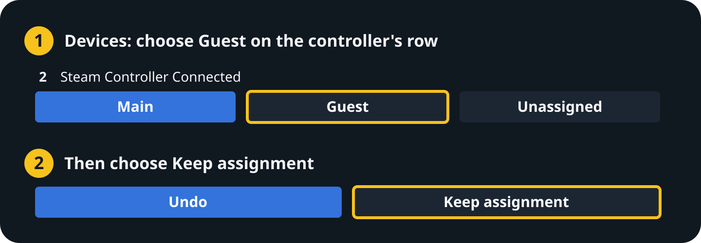
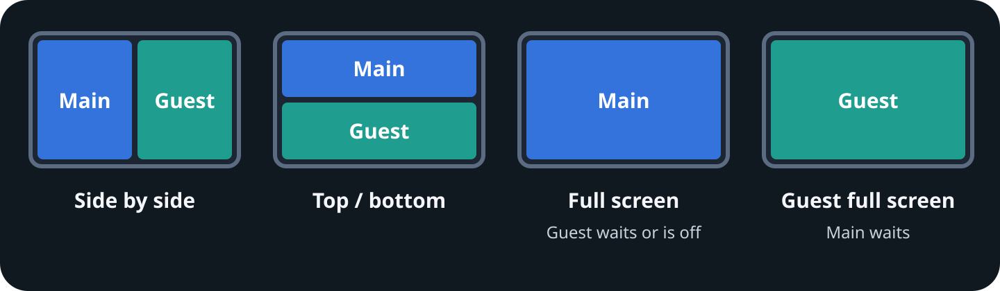

# Controllers and the screen

## Controllers

- The first controller you wake is Main's. The next one is Guest's while Guest has none.
- Main can move a controller at any time, on the **Devices** page.
- A mouse or keyboard is Main's. **Shared** lets both sides use it.

## Layout

Main chooses it on the **Session** page.

## Picture size

On the **Display** page, **Native** uses every pixel of your part of the screen.

A game starts wrong or looks wrong? Choose **16:9**, **4:3** or **1:1**, then **Apply**.
