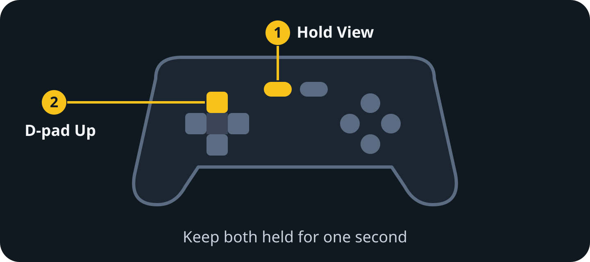

# The menu

The first line says whose menu it is, for example **DosPlex · Main**.

| Page | What you set there |
|---|---|
| **Display** | Picture size, frame-rate counter, brightness |
| **Devices** | Who has which controller, mouse and keyboard |
| **Audio** | Where your sound goes, which microphone is yours |
| **Session** | Reset your side. *Main only:* layout, power, **Turn off DosPlex** |

## Open the menu

| On | Do this |
|---|---|
| Steam Controller | Hold <kbd>Select / Back / View</kbd>, press <kbd>D-pad Up</kbd>, keep both for one second. |
| Steam Deck | Hold <kbd>View</kbd>, press <kbd>D-pad Up</kbd>, keep both for one second. |
| Keyboard | <kbd>Ctrl</kbd>+<kbd>Shift</kbd>+<kbd>M</kbd> or <kbd>Super</kbd>+<kbd>Shift</kbd>+<kbd>M</kbd> |
| Other gamepad | Same chord as the Steam Controller. Experimental. |

Move with the D-pad or a stick. <kbd>A / Cross</kbd> selects. <kbd>B / Circle</kbd> goes back or closes. On a keyboard use the arrow keys, <kbd>Enter</kbd> and <kbd>Escape</kbd>.

> [!WARNING]
> Other gamepads (DualShock 4, DualSense, Xbox, Switch Pro) cannot be filtered. The chord also reaches the game, and your side is paused while the menu is open: an online game may drop its connection. To switch this off, run `sudo touch /var/lib/dosplex/gamepad-menu-off` and restart DosPlex.

## Help

- The **?** button beside **X** opens a cheat sheet of three pages, at the one for your page.
- Up and down read. Left and right change chapter. <kbd>B</kbd> closes it.
- The other player keeps playing.

## Whose menu is it

- Each menu controls its own side. Main also has layout and session controls. Actions that affect both ask first.
- One menu is open at a time. Main's replaces Guest's and cancels what Guest was about to confirm. Guest cannot open it while Main's is open.
- In Full screen only Main has a menu. In Guest full screen both do.

More: [the user guide](../user-guide.md#open-your-menu).
